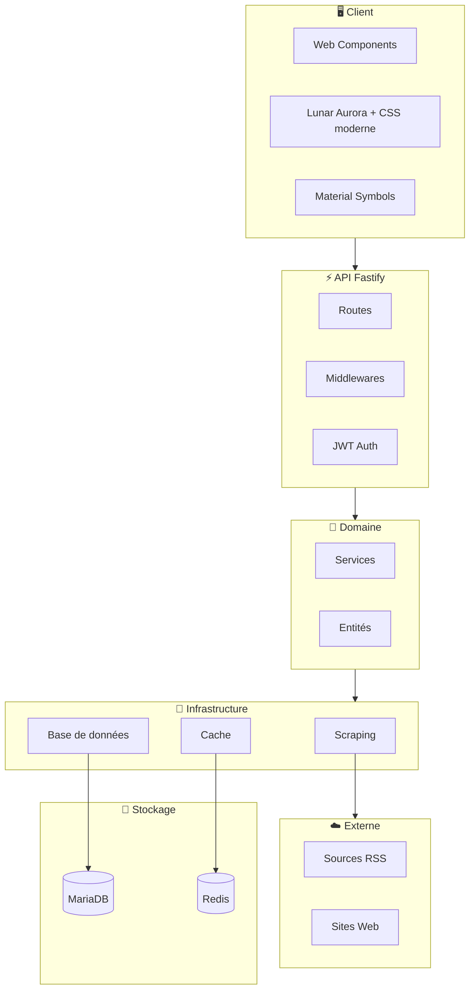
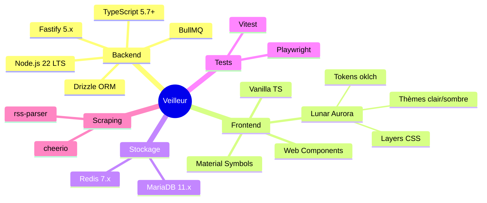
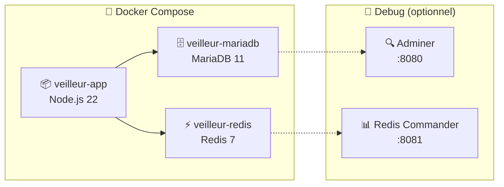
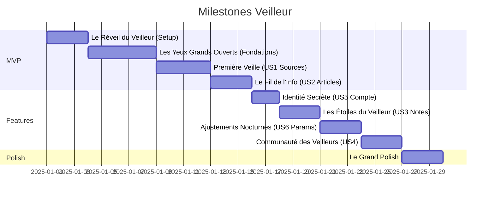

<p align="center">
  <pre>
██╗   ██╗███████╗██╗██╗     ██╗     ███████╗██╗   ██╗██████╗ 
██║   ██║██╔════╝██║██║     ██║     ██╔════╝██║   ██║██╔══██╗
██║   ██║█████╗  ██║██║     ██║     █████╗  ██║   ██║██████╔╝
╚██╗ ██╔╝██╔══╝  ██║██║     ██║     ██╔══╝  ██║   ██║██╔══██╗
 ╚████╔╝ ███████╗██║███████╗███████╗███████╗╚██████╔╝██║  ██║
  ╚═══╝  ╚══════╝╚═╝╚══════╝╚══════╝╚══════╝ ╚═════╝ ╚═╝  ╚═╝

  </pre>
</p>

<p align="center">
  
</p>

<h1 align="center">Veilleur</h1>

<p align="center">
  <strong>Votre sentinelle de l'information</strong>
</p>

<p align="center">
  <a href="https://news.nethttp.net">Démo</a> •
  <a href="#-fonctionnalités">Fonctionnalités</a> •
  <a href="#-démarrage-rapide">Démarrage</a> •
  <a href="#-déploiement">Déploiement</a> •
  <a href="#-stack-technique">Stack</a> •
  <a href="#-documentation">Documentation</a>
</p>

<p align="center">
  
  
  
  
  
  
  <a href="https://news.nethttp.net"></a>
</p>

<p align="center">
  
  
  
  
</p>

---

## 📖 À propos

**Veilleur** est un agrégateur d'actualités libre et open source. Ajoutez vos sources RSS et sites web favoris, personnalisez votre fil d'actualités, et découvrez de nouvelles sources via la communauté.

> *« Restez informé, simplement. »*

---

## ✨ Fonctionnalités

<table>
<tr>
<td width="50%">

### 📰 Agrégation
- Ajout de sources RSS et sites web : collez l'adresse du site (`mediapart.fr`), le flux et le protocole sont détectés automatiquement
- Favicon et tags de la source récupérés automatiquement à l'ajout (catégories du flux, mots-clés du site) ; favicons mis en cache et servis par Veilleur, le navigateur ne contacte jamais les sites sources
- Extraction des métadonnées (Open Graph, Twitter Cards)

### 🎯 Personnalisation
- Notation des sources (1-5 étoiles)
- Fil en liste ou en tuiles (grille fluide), au choix et mémorisé ; mise en page pleine largeur
- Barre de commandes compacte (recherche, tri, panneau de filtres, bascules) et rail dépliable des rubriques, tendances et mots-clés
- Tags de sources déduits automatiquement, modifiables à la main ; ils forment les rubriques du fil, avec le compte de non-lus. Chaque tag porte une couleur stable dérivée de son nom (roue de teintes oklch harmonisée avec le thème, clair et sombre)
- Articles notés et mis en favoris, classés automatiquement par cinq mots-clés extraits du texte
- Fil trié (date, note, titre, source), filtré par source, période, note, favoris, liste de lecture, non lus et mots-clés, avec chargement au défilement
- Recherche plein texte avec exclusions (`-mot`), phrases exactes et préfixes, termes surlignés dans les cartes
- Lu / non lu : lecture automatique à l'ouverture, filtre « Non lus », compteurs par source, « Tout marquer lu »
- Lecture en place : le contenu de l'article, extrait et nettoyé côté serveur, s'ouvre dans une fenêtre sans quitter le fil
- Liste de lecture « à lire plus tard » et export de toutes les annotations en JSON ou CSV
- Paramètres avancés par source
- Paramètres en pleine largeur avec navigation latérale : compte, sécurité (mot de passe, 2FA), notifications, application et données
- Thème clair, sombre ou automatique en un clic dans l'en-tête, mémorisé dans le navigateur
- Raccourci `/` vers la recherche, retour en haut du fil, navigation compacte sur mobile

</td>
<td width="50%">

### 🌐 Communauté
- Découverte de sources populaires
- Mots-clés tendance (24 h contre 7 jours) sur le fil et sur toute la plateforme
- Filtrage par tags
- Notes moyennes communautaires
- Articles les plus appréciés de la semaine, suggestions de sources d'après les lecteurs aux goûts proches, partage d'articles

### 📱 Application installable
- PWA : manifeste, icônes, raccourcis, coque consultable hors ligne, installation depuis les paramètres

### 🔔 Notifications
- Web Push après chaque synchronisation (regroupé, au plus une fois par demi-heure, réglable par source)
- Résumé courriel quotidien ou hebdomadaire des articles non lus, groupé par source

### 🏅 Parcours
- Points, six niveaux, douze badges et série de jours de lecture, déduits de votre activité
- Classement public sur la base du volontariat, sous pseudo

### 🛡️ Administration
- Dans les Paramètres, un groupe « Administration » réservé aux administrateurs : statistiques anonymes et graphiques sur 30 jours, gestion des comptes (rôle, désactivation, suppression) et des sources (synchronisation, statut) dans des tables triables, état du système (Redis, base, files)
- Le premier compte de l'instance est administrateur ; `npm run admin:promouvoir:prod -- <email>` en promeut un autre

### ⚡ Performance
- Cache agressif (90% hit rate)
- Réponses < 200ms (p95)
- 1000 utilisateurs simultanés

</td>
</tr>
</table>

---

## 🏗️ Architecture



---

## 🚀 Démarrage Rapide

### Avec Docker (Recommandé)

```bash
# 1. Cloner le projet
git clone https://github.com/yrbane/veilleur.git
cd veilleur

# 2. Configurer et démarrer
cp .env.example .env
make dev
```

<p align="center">
  
  
  
</p>

### 📋 Commandes Make

| Commande | Description |
|:---------|:------------|
| `make dev` | 🟢 Démarrer l'environnement |
| `make down` | 🔴 Arrêter les conteneurs |
| `make logs` | 📜 Voir les logs |
| `make shell` | 💻 Shell dans l'app |
| `make db-shell` | 🗄️ Shell MariaDB |
| `make test` | 🧪 Lancer les tests |
| `make debug` | 🔧 Avec outils admin |
| `make help` | ❓ Toutes les commandes |

### Sans Docker

```bash
git clone https://github.com/yrbane/veilleur.git
cd veilleur
npm install
cp .env.example .env
# Configurer MariaDB et Redis localement
npm run db:migrate
npm run db:seed      # sources par défaut (optionnel)
npm run dev
```

### Build de production

```bash
npm run build        # typecheck + bundle serveur (esbuild) + client (Vite)
npm run db:migrate:prod   # migrations via dist/migrer.js (sans drizzle-kit)
npm start            # node dist/serveur.js — API + workers + frontend sur :8080
```

Le bundle esbuild (`scripts/build-serveur.mjs`) résout les alias `@/` et produit
`dist/serveur.js`, `dist/migrer.js` et `dist/seed.js`, exécutables directement par Node.

---

## 🛠️ Stack Technique



### Détail des technologies

<table>
<tr>
<th>Catégorie</th>
<th>Technologie</th>
<th>Rôle</th>
</tr>
<tr>
<td rowspan="5">🔙 Backend</td>
<td></td>
<td>Runtime JavaScript</td>
</tr>
<tr>
<td></td>
<td>Framework web performant</td>
</tr>
<tr>
<td></td>
<td>Typage statique</td>
</tr>
<tr>
<td></td>
<td>ORM type-safe</td>
</tr>
<tr>
<td></td>
<td>File de tâches Redis</td>
</tr>
<tr>
<td rowspan="4">🎨 Frontend</td>
<td></td>
<td>Composants natifs</td>
</tr>
<tr>
<td></td>
<td>Framework CSS (tokens oklch, thèmes, composants)</td>
</tr>
<tr>
<td></td>
<td>Icônes, police auto-hébergée</td>
</tr>
<tr>
<td></td>
<td>Build tool</td>
</tr>
<tr>
<td rowspan="2">💾 Stockage</td>
<td></td>
<td>Base de données relationnelle</td>
</tr>
<tr>
<td></td>
<td>Cache et sessions</td>
</tr>
<tr>
<td rowspan="2">🧪 Tests</td>
<td></td>
<td>Tests unitaires</td>
</tr>
<tr>
<td></td>
<td>Tests E2E</td>
</tr>
<tr>
<td rowspan="2">🔍 Scraping</td>
<td></td>
<td>Parsing HTML</td>
</tr>
<tr>
<td></td>
<td>Parsing RSS/Atom</td>
</tr>
</table>

---

## 🐳 Docker

### Services



### Volumes persistants

| Volume | Contenu |
|:-------|:--------|
| `veilleur-mariadb-data` | Données MariaDB |
| `veilleur-redis-data` | Données Redis (AOF) |

---

## 🚀 Déploiement

L'instance publique tourne sur **https://news.nethttp.net** (Debian 13, sans Docker :
MariaDB et Redis natifs, Apache en reverse proxy derrière le pare-feu applicatif websec).

**Déploiement continu** : chaque push (merge) sur `main` déclenche le workflow
[`deploy-nethttp.yml`](.github/workflows/deploy-nethttp.yml) — lint, typecheck, tests et
build, puis rsync SSH et installation sur le serveur (secrets `NETHTTP_SSH_KEY` et
`NETHTTP_KNOWN_HOSTS`). Les pull requests n'exécutent que la vérification.

Déploiement manuel, même résultat :

```bash
npm run deploy:nethttp
```

Le script `scripts/deploy-nethttp.sh` construit l'application, envoie `dist/`, les
migrations et les manifestes par rsync, puis exécute `deploy/nethttp/installer.sh`
en root sur le serveur. Cet installeur est **idempotent** :

| Étape | Premier passage | Passages suivants |
|:------|:----------------|:------------------|
| Node 22 LTS dans `/opt/nodejs` | téléchargé, somme SHA-256 vérifiée | conservé |
| Utilisateur système `veilleur` | créé | conservé |
| `/var/www/nethttp.net/news/.env` | généré (mot de passe BDD, secrets JWT) | jamais écrasé |
| Base MariaDB `veilleur` | créée | mot de passe resynchronisé |
| Code + `npm ci --omit=dev` | installé | mis à jour |
| Migrations Drizzle | appliquées | appliquées |
| Sources par défaut | insérées | ignorées (`.seed-fait`) |
| Service systemd `veilleur` | installé, activé | redémarré |
| Vhost Apache `015-news.nethttp.net.conf` | activé | rechargé |

Fichiers : `deploy/nethttp/veilleur.service` (service durci, seul `data/images` est
inscriptible), `deploy/nethttp/015-news.nethttp.net.conf` (proxy vers `127.0.0.1:8090`),
`deploy/nethttp/env.production` (modèle d'environnement).

Migrations et sources par défaut tournent via `systemd-run` avec le même
`EnvironmentFile` que le service : le `.env` suit la syntaxe systemd, et toute
valeur contenant un espace, une parenthèse ou un chevron (`SCRAPING_USER_AGENT`,
`SMTP_FROM`) doit être entre guillemets doubles.

```bash
ssh nethttp 'journalctl -u veilleur -n 100 -f'   # logs
ssh nethttp 'sudo systemctl status veilleur'      # état du service
```

---

## 📚 Documentation

| Document | Description |
|:---------|:------------|
| 📋 [Spécification](./specs/001-agregateur-actualites/spec.md) | User stories et exigences |
| 🗺️ [Plan](./specs/001-agregateur-actualites/plan.md) | Plan d'implémentation |
| 📊 [Data Model](./specs/001-agregateur-actualites/data-model.md) | Schéma de données |
| 🔌 [API](./specs/001-agregateur-actualites/contracts/api.yaml) | Contrat OpenAPI |
| 🔬 [Recherche](./specs/001-agregateur-actualites/research.md) | Choix techniques |
| 🚀 [Quickstart](./specs/001-agregateur-actualites/quickstart.md) | Guide de démarrage |
| ✅ [Tâches](./specs/001-agregateur-actualites/tasks.md) | 101 tâches à réaliser |

---

## 📈 Roadmap



---

## 🎯 Principes

<table>
<tr>
<td align="center" width="14%">

<br/><sub>Tests avant code</sub>
</td>
<td align="center" width="14%">

<br/><sub>Security by design</sub>
</td>
<td align="center" width="14%">

<br/><sub>Cache agressif</sub>
</td>
<td align="center" width="14%">

<br/><sub>Code propre</sub>
</td>
<td align="center" width="14%">

<br/><sub>Ergonomie</sub>
</td>
<td align="center" width="14%">

<br/><sub>Tout en français</sub>
</td>
<td align="center" width="14%">

<br/><sub>Beauté du code</sub>
</td>
</tr>
</table>

---

## 🤝 Contribution

Les contributions sont les bienvenues ! Consultez les [issues](https://github.com/yrbane/veilleur/issues) pour voir les tâches disponibles.

```bash
# Fork et clone
git clone https://github.com/votre-user/veilleur.git

# Créer une branche
git checkout -b feature/ma-fonctionnalite

# Développer avec TDD
make test-watch

# Push et PR
git push origin feature/ma-fonctionnalite
```

---

## 📄 Licence

<p align="center">
  
</p>

---

<p align="center">
  <sub>Fait avec ❤️ par la communauté</sub>
</p>

<p align="center">
  <a href="https://github.com/yrbane/veilleur">
    
  </a>
</p>
